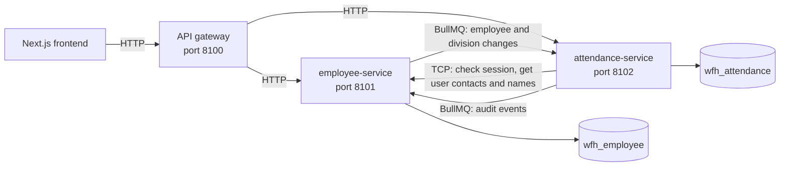

# wfh-app (Hadir.in)

Hadir.in is a web-based attendance system for people who work from home. It replaces attendance tracked through chat, spreadsheets and ad-hoc forms with one consistent record, based on server time, that managers and HR can monitor, correct through a formal process, and report on.

**This repository is the microservices version.** Its backend is split into an employee service and an attendance service behind an API gateway, each with its own database.

**Live demo:** [hadir-in.armerta.biz.id](https://hadir-in.armerta.biz.id) runs the earlier single-service version of the same product.

## Who it's for

| Role         | What they do in Hadir.in                                                                                          |
| ------------ | ----------------------------------------------------------------------------------------------------------------- |
| **Employee** | Check in and out, see today's status and their history, and request a correction when something is wrong          |
| **Manager**  | See who on their team has checked in or out, review team reports, and decide their direct reports' corrections    |
| **Admin/HR** | Manage employees, divisions, schedules and holidays, monitor the organization, decide corrections, export reports |

## What it does

- **Daily attendance:** check-in and check-out use server time, so a device's clock can't affect the record. Each employee has at most one record per work date, and retries and double clicks don't create duplicates.
- **Schedules and holidays:** the schedule is set for the whole organization and versioned. Each record keeps the schedule it was judged by, so later changes don't rewrite history. Check-ins on weekends and holidays are rejected.
- **Absence:** a nightly job marks eligible employees without a record as absent.
- **Corrections:** employees can request a change for up to seven days after the work date. Their direct manager or Admin/HR decides, the first decision is final, and nobody can decide their own request.
- **Dashboards and reports:** team and organization views, attendance trends and CSV export.
- **Notifications:** emails about corrections, check-in and check-out reminders, a notification centre in the app, and per-user email preferences.
- **Audit log:** changes to attendance through corrections, and administrative changes, can be traced.

The default policy is Monday to Friday, 09:00–17:00 in `Asia/Jakarta`, with 15 minutes of late tolerance.

- **Photo proof:** each check-in and check-out needs a photo, which Admin/HR can open and every view is audited. Location checks are available as a setting. Both are off in production until a privacy and legal review is complete.

Hadir.in deliberately doesn't calculate payroll or track activity, screens or productivity, and it doesn't use biometric matching.

## Architecture



| Service              | Responsible for                                                                                   |
| -------------------- | ------------------------------------------------------------------------------------------------- |
| **API gateway**      | One entry point for clients. Routes each request and holds no data or business rules.             |
| `employee-service`   | Sign-in, users and roles, employee master data, divisions, the audit log, file uploads            |
| `attendance-service` | Check-in and check-out, photo evidence, corrections, schedules, holidays, reports, notifications  |

- **Each service owns its data.** Neither connects to the other's database, and `src/apps/service-boundaries.spec.ts` fails the build if a module crosses the line.
- **Request-response over TCP.** The attendance service asks the employee service to validate each session, so logging out takes effect immediately.
- **Events over queues.** Employee changes and audit events go through BullMQ, so a message waits in Redis if its consumer is down.
- **A local copy for reports.** Reports sort and filter by employee fields, which can't be done efficiently across two databases, so the attendance service keeps a copy of employees and divisions. Messages carry the full row and older ones are ignored, so repeats and reordering are safe.

**Trade-offs.** A change to an employee takes a moment to reach the attendance service, and attendance requests fail if the employee service is down, since sessions live there. Attendance, corrections and reports stay in one service because they share database transactions. [The split document](docs/EMPLOYEE_ATTENDANCE_SPLIT_PLAN.md) covers each decision, and what would be needed before deploying this.

## Tech stack

| Part                     | Technology                                                                                                       |
| ------------------------ | ---------------------------------------------------------------------------------------------------------------- |
| [`backend/`](backend/)   | NestJS 12, TypeScript, NestJS microservices (TCP), PostgreSQL 17 with Prisma 7, Redis with BullMQ                 |
| [`frontend/`](frontend/) | Next.js 16, React 19, TypeScript, Tailwind CSS 4, shadcn/ui, TanStack Query                                      |
| [`docs/`](docs/)         | Product and design documents                                                                                     |

Timestamps are stored in UTC, while work dates and statuses are calculated in the organization's time zone.

## Run it locally

Requires Node 24, pnpm and Docker.

```bash
cd backend
cp .env.example .env
```

Set `JWT_ACCESS_SECRET` (32+ characters) and `SEED_ADMIN_PASSWORD` (12+ characters) in `.env`, then:

```bash
pnpm install
docker compose up -d
pnpm db:deploy
pnpm db:seed
pnpm dev
```

In a second terminal:

```bash
cd frontend
cp .env.example .env.local
```

Set `SESSION_SECRET` (32+ characters) in `.env.local`, and set `DEMO_LOGIN_PASSWORD` to your `SEED_ADMIN_PASSWORD` for one-click test personas, then:

```bash
pnpm install
pnpm dev --port 3100
```

Open http://localhost:3100. See the [backend README](backend/README.md) for the demo accounts.

## Tests

```bash
cd backend
pnpm lint && pnpm typecheck && pnpm test && pnpm test:e2e
```

Each e2e test starts the real gateway and both services on their own ports, so requests cross HTTP, TCP and the queues. They need the Docker containers above. The frontend has its own suite: `pnpm lint && pnpm typecheck && pnpm test` in `frontend/`.
