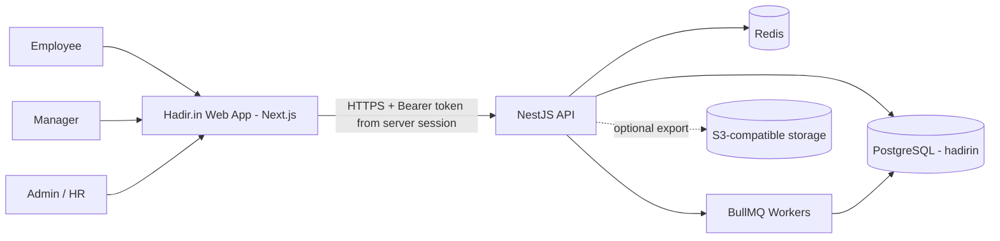
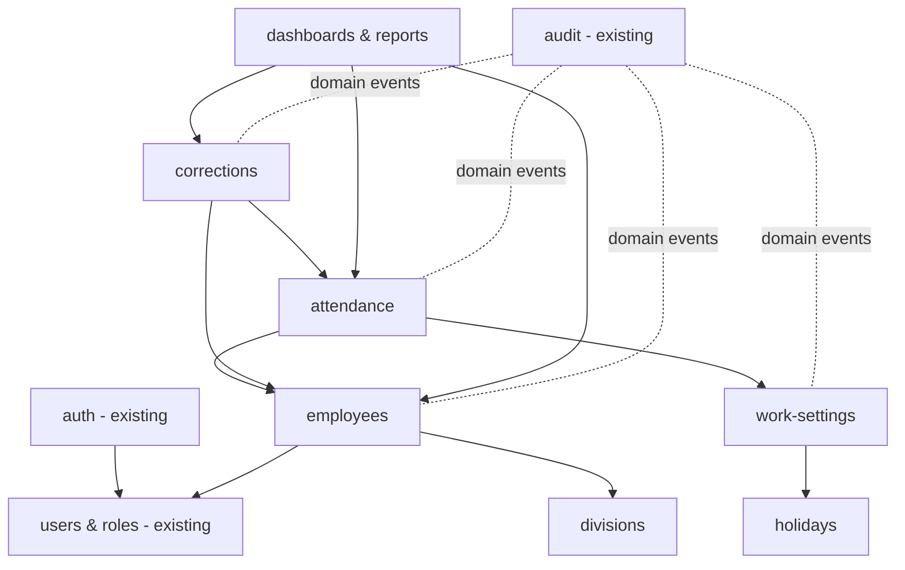
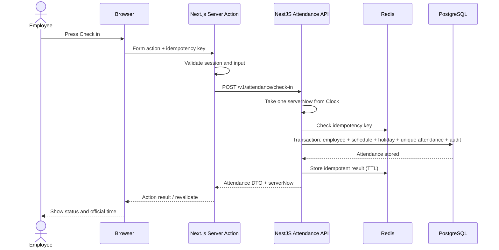
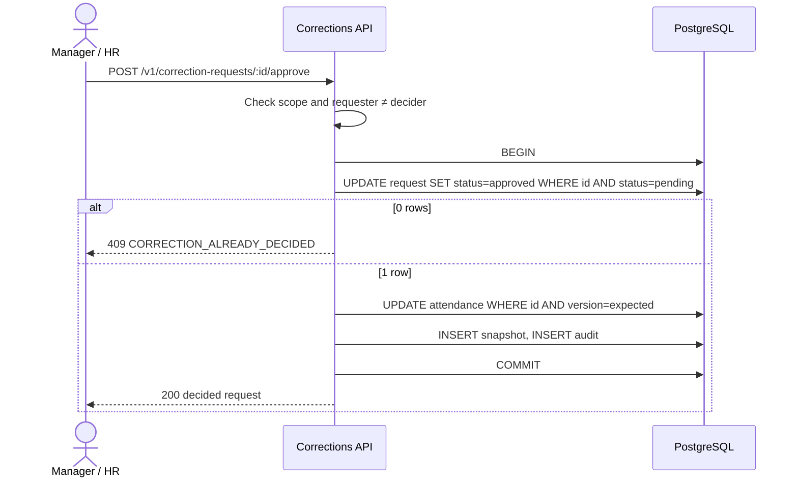
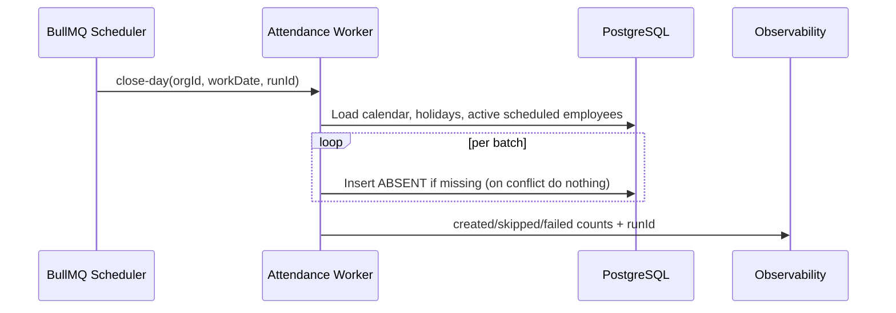

# Architecture — Hadir.in

| Attribute    | Value                                                  |
| ------------ | ------------------------------------------------------ |
| Status       | Target architecture for the baseline scope             |
| Version      | 0.2                                                    |
| Date         | 30 October 2026                                        |
| Requirements | `PRODUCT_REQUIREMENTS.md`                              |
| Domain rules | `DOMAIN_RULES.md`                                      |
| Data model   | `DATA_MODEL.md`                                        |

## 1. Purpose

This document describes how the frontend and backend work together to meet the PRD without mixing product rules with framework details. The architecture keeps the existing boilerplate conventions and adds the attendance domain as modules. It is an extension of the boilerplates, not a replacement.

## 2. Current repository state

The workspace contains two separate applications:

| Application            | Current stack                                                            | Relevant state                                                                                                                         |
| ---------------------- | ------------------------------------------------------------------------ | -------------------------------------------------------------------------------------------------------------------------------------- |
| `frontend` | Next.js 16.4.3 App Router, React 19, TypeScript, Tailwind, shadcn/ui, Zod, TanStack Query, Recharts | Login, session cookies, refresh token, user management, audit UI, files, placeholder dashboard, server actions, typed API client. |
| `backend`  | NestJS, Prisma 7, PostgreSQL 17, Redis/BullMQ, JWT, Zod, OpenAPI         | Auth (with `REGISTRATION_ENABLED` flag), users/roles/permissions, sessions, audit log, uploads, mail, queues, health checks, layered modules. |

Employee, division, schedule, holiday, attendance, and correction domains do not exist in the schema yet. The sections below describe the target, not implemented features.

### 2.1 Reuse and adaptation of boilerplate features

| Boilerplate feature              | Hadir.in use                                                                      |
| -------------------------------- | --------------------------------------------------------------------------------- |
| Auth, sessions, refresh tokens   | Reused as-is for login/logout and session management.                             |
| Public registration              | Disabled (`REGISTRATION_ENABLED=false` in both apps); Admin/HR creates accounts.  |
| User invitations / accept-invite | Reused to onboard employee accounts.                                              |
| Users, roles, permissions        | Extended with new permissions and the `admin_hr`, `manager`, `employee` roles.    |
| Audit log module and UI          | Reused for all domain audit events.                                               |
| Uploads/storage                  | Reused only if async CSV export is built.                                         |
| BullMQ queues                    | Reused for the close-day job.                                                     |
| App shell, sidebar, command menu | Extended with Hadir.in navigation and branding.                                   |
| Example dashboard                | Replaced by a placeholder; role-aware Hadir.in dashboards come in Phase 4.        |
| Example invoices pages           | Deleted (feature, routes, nav entry, tests).                                      |

## 3. Architecture principles

1. **The backend is the source of truth.** Time, permissions, domain rules, and state changes are validated in the backend.
2. **OpenAPI is the contract between apps.** `backend/openapi.json` is generated from controllers/DTOs, and frontend types are generated from it.
3. **Organization isolation in every query.** All domain access carries `organizationId` from the authenticated session, never from free client input.
4. **Transactions for invariants.** Check-in, check-out, correction decisions, and close-day use transactions and database constraints.
5. **Server Components by default.** The frontend queries server-side; interactivity is limited to the smallest client islands.
6. **Asynchronous only when needed.** Attendance transactions are synchronous; close-day and large exports use queues.
7. **History is never silently recalculated.** Attendance stores a snapshot of the schedule used.
8. **Observability from the start.** Request IDs, audit events, structured logs, and health checks are part of every flow.
9. **Two services, split on purpose.** Employee and attendance are separate services with separate databases behind a gateway (`EMPLOYEE_ATTENDANCE_SPLIT_PLAN.md`). The rest of this document was written for one backend: read "the backend" as both services together. Attendance, corrections and reports stay in one service because they share transactions.
10. **Extend, don't replace.** New modules follow the existing controller → service → repository pattern, existing guards, error filter, and validation.

## 4. System context



The browser never accesses PostgreSQL, Redis, or object storage directly.

## 5. Runtime topology

### 5.1 Frontend

- Next.js serves pages, layouts, loading states, and error boundaries.
- Access/refresh tokens live only in `HttpOnly` cookies; client JavaScript never reads tokens.
- Server Components fetch data through `src/lib/api`.
- Server Actions handle mutations: validate input, read the session, then call the API.
- The existing auth proxy refreshes tokens when the access token expires.
- TanStack Query is used only for data that needs client polling/refresh, such as today's dashboard counts.
- Recharts (already installed) renders attendance trends.

### 5.2 Backend API

Requests follow the existing pipeline:

```text
HTTP request
  → request ID / structured logging
  → Helmet / CORS / rate limit
  → JWT + active-session guard
  → permission guard
  → Zod DTO validation
  → Controller
  → Service (domain rules + transactions)
  → Repository (Prisma queries)
  → PostgreSQL
  → response DTO / standard error filter
```

Controllers contain no business rules. Only a module's repository accesses that module's Prisma models. Services may open transactions and orchestrate other modules' services.

### 5.3 Worker

BullMQ workers run in a process that can be separated from the API if load grows. Responsibilities:

- Close-day processing (marking `ABSENT`).
- Large report exports and deleting export artifacts after 24 hours (only if async export is built).
- Idempotency record cleanup.

Jobs carry `organizationId`, correlation ID, payload version, and a deduplication key. Jobs must be idempotent and retry-safe.

### 5.4 Data stores

- **PostgreSQL:** transactional source of truth for identity, configuration, attendance, corrections, and audit. Database name `hadirin` for new local setups (the existing compose default `app` keeps working; see §17).
- **Redis:** BullMQ, deduplication/idempotency cache with TTL, and disposable cache. Never the source of truth for attendance.
- **S3-compatible storage:** temporary export files only. Metadata stays in PostgreSQL.

## 6. Backend module boundaries



### 6.1 `employees`

Owns employee profiles and their links to user, division, and direct manager. Enforces employee number rules, employment period, active status, cycle-free reporting lines, and team scope (`isDirectReport`, `listDirectReports`) used by other modules.

### 6.2 `divisions`

Owns division master data. Other modules use `DivisionsService` to verify a division belongs to the same organization.

### 6.3 `work-settings`

Owns organization timezone, support contact, retention setting, schedule versions, and effective-schedule resolution. The baseline enables only the organization schedule; the model stays extensible for division/employee schedules.

### 6.4 `holidays`

Owns public holidays and answers `isWorkingDay(organizationId, date)` together with the schedule's working days.

### 6.5 `attendance`

Owns check-in/out, history, schedule snapshots, status, completion, idempotency, and the close-day job. Uses `EmployeesService`, `WorkSettingsService`, and `HolidaysService` instead of reading their tables directly. Hosts the shared domain calculator (status, late minutes, worked minutes, completion) and the `Clock` abstraction.

### 6.6 `corrections`

Owns request lifecycle, reviewer scope, before/after snapshots, and applying approved corrections. Orchestrates a transaction with `AttendanceService` through an explicit service API.

### 6.7 `reports` (dashboards and reports)

Provides read-only summary, dashboard, trend, and export queries. For complex cross-aggregate queries, the reports repository may read dedicated read models/views, never as a mutation path.

### 6.8 `audit` (existing)

Follows the boilerplate convention: modules never write audit rows. After a successful commit, each module emits an `AuditableEvent` with `emitAsync()` (so the response waits until the row is written), and `AuditListener` records it through one `@OnEvent("<namespace>.*")` handler per module (`division.*`, `employee.*`, `work_schedule.*`, `holiday.*`, `attendance.*`, `correction.*`, `report_export.*`). Because the write happens after commit, a listener failure can lose an audit row; this is accepted for the initial scope and logged as an error. A transactional outbox is a deferred decision (§19).

## 7. Target code structure

### Backend

```text
backend/src/modules/
  auth/              # existing
  users/             # existing (roles, permissions)
  audit/             # existing
  uploads/           # existing
  employees/
    dto/
    employees.controller.ts
    employees.service.ts
    employees.repository.ts
    employees.errors.ts
    employees.module.ts
  divisions/
  work-settings/
  holidays/
  attendance/
    dto/
    jobs/
    domain/          # calculator, clock
    attendance.controller.ts
    attendance.service.ts
    attendance.repository.ts
    attendance.errors.ts
    attendance.module.ts
  corrections/
  reports/
```

New files follow the naming and layering already used by `users/` and `audit/`; check `backend/docs/03-modules-and-layers.md` before adding a module.

### Frontend

```text
frontend/src/
  app/(app)/
    dashboard/              # existing route, role-aware Hadir.in dashboards
    attendance/
    attendance/history/
    corrections/
    corrections/review/
    team/
    reports/
    employees/
    divisions/
    holidays/
    settings/attendance/
    profile/
    users/                  # existing
    audit-log/              # existing
  features/
    attendance/
    corrections/
    team/
    reports/
    employees/
    divisions/
    holidays/
    work-settings/
```

Each feature follows the existing `queries.ts`, `actions.ts`, `schemas.ts`, `contract.ts`, and `components/` pattern as needed; do not create empty files just to match the pattern.

### Branding

Hadir.in branding is applied through the existing theme tokens in `src/app/globals.css` (OKLCH, `:root` and `.dark`), respecting shadcn token semantics:

| Brand color          | Token(s)                                                         |
| -------------------- | ---------------------------------------------------------------- |
| Primary `#A50034`    | `--primary`, `--ring`, `--sidebar-primary`, `--chart-1`          |
| Secondary `#D50032`  | new `--brand-secondary`, `--chart-2`                             |
| Accent `#B22234`     | new `--brand-accent`, `--chart-3`                                |
| Background `#FFFFFF` | `--background`, `--card`                                         |
| Soft `#F7C6C7`       | `--accent` and `--sidebar-accent` (shadcn's hover/highlight slot) |

shadcn's `--secondary` stays a neutral button background, and `--accent` must stay light because it is the hover color. Dark-mode variants are defined for every changed token. Contrast is checked for foreground pairs; status badges use text + icon, not color alone. The logo is a text wordmark "Hadir.in" in the existing sidebar header slot. No new component library is added.

## 8. Target API contract

This list is a resource design, not a replacement for OpenAPI. Final endpoints must appear in `openapi.json`, and frontend types must be regenerated. Permission names are defined in `DATA_MODEL.md` §4.2.

### 8.1 Self-service

| Method  | Path                                | Permission          | Purpose                                                  |
| ------- | ----------------------------------- | ------------------- | -------------------------------------------------------- |
| `GET`   | `/v1/me/employee`                   | authenticated       | Own employee profile.                                    |
| `GET`   | `/v1/me/context`                    | authenticated       | App shell: organization name, time zone, today's work date, support contact, own profile summary. |
| `GET`   | `/v1/attendance/today`              | `attendance:self`   | Today's status, server time, schedule, allowed actions.  |
| `POST`  | `/v1/attendance/check-in`           | `attendance:self`   | Check in using server time.                              |
| `POST`  | `/v1/attendance/check-out`          | `attendance:self`   | Check out today's record.                                |
| `GET`   | `/v1/attendance/me`                 | `attendance:self`   | Own history (date range, status, incomplete, pagination). |
| `GET`   | `/v1/attendance/me/summary`         | `attendance:self`   | Own summary for a range or month.                        |
| `GET`   | `/v1/attendance/:id`                | self or scoped      | Record detail with correction history.                   |

Check-in/out require an `Idempotency-Key` header (`IDEMPOTENCY_KEY_REQUIRED` otherwise) and take an empty body. A replay returns the first result with `Idempotent-Replayed: true`. The API never accepts check-in/out timestamps, employee, organization, or status. `GET /v1/attendance/:id` returns own records only until the team/organization views exist. Attendance responses carry `corrected` and `pendingCorrectionId`.

### 8.2 Corrections

| Method | Path                                    | Permission                                        | Purpose                           |
| ------ | --------------------------------------- | ------------------------------------------------- | --------------------------------- |
| `POST` | `/v1/correction-requests`               | `correction:submit`                               | Submit a correction.              |
| `POST` | `/v1/correction-requests/preview`       | `correction:submit`                               | Proposal outcome, not saved.      |
| `GET`  | `/v1/correction-requests/me`            | `correction:submit`                               | Own requests (status, record).    |
| `GET`  | `/v1/correction-requests`               | `correction:decide_team` / `correction:decide_all`| Review queue in scope.            |
| `GET`  | `/v1/correction-requests/:id`           | requester or scoped reviewer                      | Detail with current vs proposed.  |
| `POST` | `/v1/correction-requests/:id/approve`   | `correction:decide_team` / `correction:decide_all`| Approve (first decision wins).    |
| `POST` | `/v1/correction-requests/:id/reject`    | `correction:decide_team` / `correction:decide_all`| Reject with a note.               |

### 8.3 Team, dashboards, and reports

| Method | Path                              | Permission                                  | Purpose                                         |
| ------ | --------------------------------- | ------------------------------------------- | ----------------------------------------------- |
| `GET`  | `/v1/team/attendance/today`       | `attendance:read_team`                      | Direct reports' status today.                   |
| `GET`  | `/v1/team/attendance`             | `attendance:read_team`                      | Direct reports' records (last 90 days).         |
| `GET`  | `/v1/dashboard/organization`      | `attendance:read_all`                       | Org counts today, pending corrections, trends.  |
| `GET`  | `/v1/reports/attendance`          | `report:read_team` / `report:read_all`      | Records + summary by range/employee/division.   |
| `GET`  | `/v1/reports/attendance/trends`   | `report:read_team` / `report:read_all`      | Daily counts over a range.                      |
| `GET`  | `/v1/reports/attendance.csv`      | `report:read_all`                           | CSV export (Should).                            |

Team views use the caller's own active employee profile (`EMPLOYEE_PROFILE_REQUIRED` otherwise) and accept dates in the last 90 days; `today` takes an optional `date`. Report and trend scope (`read_team` / `read_all`) is checked in the service. The CSV streams the full filtered result synchronously and is audited as `report_export.created`.

### 8.4 Administration

| Method        | Path                         | Permission          | Purpose                                                   |
| ------------- | ---------------------------- | ------------------- | --------------------------------------------------------- |
| CRUD          | `/v1/employees`              | `employee:manage`   | Employee profiles, division, manager, activation.         |
| `POST`        | `/v1/employees/:id/account`  | `employee:manage` + `user:manage` | Invite (`mode: invite`) or link (`mode: link`) a user; set its role. |
| CRUD          | `/v1/divisions`              | `division:manage`   | Divisions.                                                |
| `GET/PATCH`   | `/v1/work-settings`          | `policy:manage`     | Timezone, support contact, retention.                     |
| `GET/POST`    | `/v1/work-schedules`         | `policy:manage`     | Schedule versions (create new effective version).         |
| `POST`        | `/v1/work-schedules/preview` | `policy:manage`     | Validate a version and show its boundaries, not saved.    |
| CRUD          | `/v1/holidays`               | `holiday:manage`    | Public holidays (`DELETE` is a soft delete).              |
| `GET`         | `/v1/work-calendar`          | `holiday:manage`    | Working days for a range (≤ 62 days) and why not.         |
| `POST`        | `/v1/attendance/close-day`   | `policy:manage`     | Re-run close-day for a date (audited).                    |

Existing `/v1/users`, `/v1/roles` (if present), and `/v1/audit-logs` endpoints are reused unchanged. Final naming, DTOs, error codes, pagination, and response statuses must be set in OpenAPI before the frontend depends on them, and must follow `backend/docs/05-api-design.md`.

## 9. Check-in flow



`Clock` is a backend abstraction that yields one `now` per operation. The production clock uses server UTC; the test clock can be frozen to test 08:00, 09:15, 17:00, midnight, and UTC/Jakarta boundaries deterministically.

## 10. Check-out flow

Check-out uses the same path, but the transaction performs a conditional update only if `checkOutAt IS NULL`. The first timestamp is never overwritten by retries or parallel requests.

## 11. Correction decision flow



A version mismatch rolls back the transaction and returns `CORRECTION_VERSION_CONFLICT`; the request stays pending. The audit entry is written right after commit through the shared event listener, like every other module.

## 12. Close-day flow



The job is scheduled at 00:05 organization time. The scheduler sends an explicit `workDate`, so a retry after time has passed never processes the wrong date. For the local demo, Admin/HR can trigger a re-run for a specific date.

Implementation: a UTC job scheduler ticks every 15 minutes and queues `close-day` (job id per organization and date, kept 3 days) for organizations past 00:05 local time. The worker inserts ABSENT rows in batches of 200 with `ON CONFLICT DO NOTHING`; failed batches make the job fail and retry. `POST /v1/attendance/close-day` runs the same logic synchronously for an ended date.

## 13. Frontend rendering and state

- The dashboard and `/attendance` are Server Components that fetch today's initial state.
- Check-in/out buttons are small client components with a pending state that prevents double-clicks.
- The Server Action creates one idempotency key per user intent and calls the API.
- On success, the action revalidates the relevant dashboard, attendance, and history pages.
- History, team, and report filters live in the URL, not global state.
- The running clock in the browser is display-only, seeded from server time. Decisions and final timestamps always come from the API.
- Never optimistically show a check-in as successful before the API confirms it.
- Navigation items are shown per permission from the session; the backend still enforces access.

## 14. Authorization

### 14.1 Roles

- `employee`: own attendance, history, corrections, profile.
- `manager`: all employee permissions plus team scope (direct reports) and team correction decisions.
- `admin_hr`: organization management, all attendance, corrections, policies, holidays, reports, users, and audit.

The backend uses granular permissions (`DATA_MODEL.md` §4.2); roles are only permission bundles stored in the existing `Role` model. Each user has one role (`User.roleId`).

### 14.2 Scope

Own/team/all scope is checked in services using organization and reporting line, not only by the permission guard. Self-approval is blocked in the corrections service and by a database check constraint.

## 15. Security

- The browser never sends `employeeId`, `organizationId`, role, status, or timestamps for its own transactions.
- DTOs are strict, and response DTOs never return internal fields.
- Every record-by-id is checked against the organization and the actor's scope.
- Check-in/out rate limits stop abuse without blocking the legitimate 09:00 burst.
- Idempotency keys can never be used to read another user's result.
- Logs never contain tokens, cookies, passwords, or raw request bodies.
- CSV export is neutralized against formula injection.
- List queries are bounded by pagination and allowlisted sort/filter fields.
- Secrets are read only through validated configuration.
- Public registration is disabled.

## 16. Reliability and failure handling

| Failure                               | Behavior                                                                                         |
| ------------------------------------- | ------------------------------------------------------------------------------------------------ |
| Browser retry/double-click            | Idempotency + unique constraint produce at most one change.                                      |
| Redis unavailable                     | No duplicates; database constraints still protect. Idempotency falls back to the database table. |
| Database unavailable                  | No false success; the UI shows an error with the request ID and allows retry.                    |
| Worker partially fails                | Batch retry; absent insert is idempotent; no duplicate records.                                  |
| Frontend fails after backend success  | Retry with the same key or refresh shows the stored result.                                      |
| Concurrent correction decisions       | Conditional update; the second decision gets a conflict.                                         |
| Host clock drift                      | Infrastructure time sync; drift is an operational alert.                                         |

## 17. Deployment and migrations

- Prisma migrations are forward-only; applied migrations are never edited.
- Schema and backend changes ship backward-compatible before the frontend that uses them.
- `openapi.json` is regenerated and committed whenever the contract changes; the frontend runs `pnpm api:types`.
- Local infrastructure reuses `backend/docker-compose.yml`, with `name: hadirin` (containers `hadirin-*`) and databases `hadirin` (dev) and `hadirin_test` (e2e). CI uses `hadirin_test` too.
- Development seed provides the Hadir.in demo dataset (`DATA_MODEL.md` §16).
- Staging is used only if already available; production is out of scope.
- Rolling back the application must never require rolling back a destructive migration. Column changes follow expand–migrate–contract when needed.

## 18. Architecture verification

### Backend

```bash
pnpm format:check
pnpm lint
pnpm typecheck
pnpm test
pnpm test:e2e
pnpm openapi
```

### Frontend

```bash
pnpm format:check
pnpm lint
pnpm typecheck
pnpm test
pnpm api:types:check
pnpm build
```

Exact script names must be confirmed against each `package.json`. Attendance tests must also cover time boundaries, timezone, concurrency, idempotency, organization isolation, negative permissions, session invalidation, self-approval, concurrent decisions, and job retries.

## 19. Deferred architecture decisions

- Read replica/materialized views for reports: only if measurement shows a need.
- Separating the worker from the API process: based on deployment capacity, not domain needs.
- Full multi-tenancy, including the same email across organizations: outside the initial launch.
- Cross-midnight shifts and per-assignment timezones: future scope.
- Asynchronous CSV export: only if synchronous streaming is insufficient.
- Transactional outbox for audit events: only if lost audit rows become a real risk.
