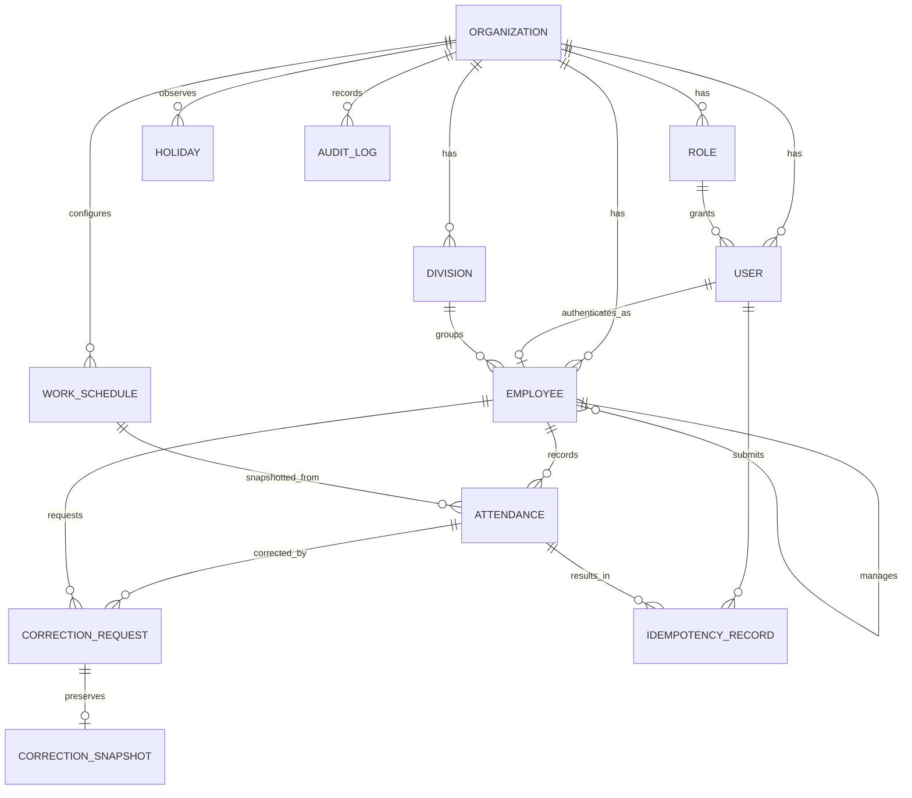

# Data Model — Hadir.in

> The tables described here now live in two databases, one per service. `backend/prisma/employee/schema.prisma` and `backend/prisma/attendance/schema.prisma` are the source of truth, and `EMPLOYEE_ATTENDANCE_SPLIT_PLAN.md` explains which rows are copied between them.

| Attribute | Value                                                   |
| --------- | ------------------------------------------------------- |
| Status    | Target logical model for the baseline scope             |
| Version   | 0.2                                                     |
| Date      | 30 October 2026                                         |
| Database  | PostgreSQL 17 via Prisma 7 (`backend`)      |

## 1. Purpose

This document turns the PRD and domain rules into an implementable data model. It is not a migration file. Final names must be checked against the Prisma schema and OpenAPI when implementation starts.

## 2. Conventions

These follow the existing `backend/prisma/employee/schema.prisma` and `backend/prisma/attendance/schema.prisma`:

- Primary keys use UUIDv7 (`@default(uuid(7)) @db.Uuid`).
- Database tables and columns use `snake_case` (`@@map`/`@map`); Prisma models/fields use `PascalCase`/`camelCase`.
- Timestamps use `timestamptz(3)` and are stored in UTC.
- Date-only values use PostgreSQL `date`.
- Schedule times use `time(0)` and are always paired with an IANA zone.
- Every tenant-owned table has `organization_id`, and main-query indexes start with it.
- Every foreign key is indexed.
- Master data uses soft delete (`deletedAt`) when history still references it.
- Historical transactions are never deleted by cascade.
- Database/API enums and UI labels are in English.
- Optional API response fields are sent as `null`, not omitted.

## 3. Entity relationships



## 4. Existing models

The current schema already has:

- `Organization`
- `Role` (with `permissions String[]`, one role per user via `User.roleId`)
- `User`
- `Session` and `RefreshToken`
- `PasswordResetToken` and `UserToken`
- `AuditLog`
- `Upload`

New models extend this schema. No second authentication, role, or audit system is created.

### 4.1 `Organization` changes

Add:

| Field            | Type         | Rule                                                      |
| ---------------- | ------------ | --------------------------------------------------------- |
| `timezone`       | varchar(64)  | Required, default `Asia/Jakarta`. Default zone before any schedule exists; afterwards the work date follows the zone of the schedule in force. |
| `supportContact` | varchar(255) | Nullable; shown in the UI as the support contact.         |
| `retentionYears` | smallint     | Required, default 5, range 1–10.                          |
| `checkInReminderEnabled` / `checkOutReminderEnabled` | boolean | Default true (Phase 6B, DOMAIN_RULES.md §18.4). |
| `checkInReminderAt` / `checkOutReminderAt` | time(0) | Default 09:00 / 18:00, in the schedule's zone. |

New relations: divisions, employees, work schedules, holidays, attendance, correction requests, and idempotency records.

### 4.2 Roles and permissions

- Roles stay rows of the existing `Role` model; permissions stay strings in `PERMISSIONS` (`src/common/types/auth.ts`).
- Seeded roles: `admin_hr`, `manager`, `employee`. The existing `owner` role keeps all permissions; the existing `member` role is kept for backward compatibility.
- New permission strings (names final at implementation):

| Permission              | `employee` | `manager` | `admin_hr` |
| ----------------------- | :--------: | :-------: | :--------: |
| `attendance:self`       |     ✓      |     ✓     |     ✓      |
| `correction:submit`     |     ✓      |     ✓     |     ✓      |
| `attendance:read_team`  |            |     ✓     |            |
| `correction:decide_team`|            |     ✓     |            |
| `report:read_team`      |            |     ✓     |            |
| `attendance:read_all`   |            |           |     ✓      |
| `correction:decide_all` |            |           |     ✓      |
| `report:read_all`       |            |           |     ✓      |
| `employee:manage`       |            |           |     ✓      |
| `division:manage`       |            |           |     ✓      |
| `policy:manage`         |            |           |     ✓      |
| `holiday:manage`        |            |           |     ✓      |
| `user:read`             |            |           |     ✓      |
| `user:manage`           |            |           |     ✓      |
| `audit:read`            |            |           |     ✓      |

Permissions grant capabilities; data scope (own / direct reports / organization) is still checked in services. Self-approval is blocked regardless of permission.

### 4.3 `User` and `Employee`

- `User` remains the login identity, role, and session owner.
- `Employee` stores HR identity, reporting line, and attendance eligibility.
- `Employee.userId` is nullable so a profile can exist before the invitation is accepted.
- A user links to at most one employee (unique constraint).
- `User.disabledAt` controls login; `Employee.status` and the employment period control attendance eligibility.

## 5. Enums

```text
EmployeeStatus
  active
  inactive

DivisionStatus
  active
  inactive

ScheduleScope
  organization
  division       # future scope
  employee       # future scope

AttendanceStatus
  present
  late
  absent
  excused        # future scope

AttendanceCompletion
  not_started    # read model only, never stored
  open
  complete
  not_applicable

AttendanceSource
  self_service
  close_day_job

CorrectionStatus
  pending
  approved
  rejected

IdempotencyAction
  attendance_check_in
  attendance_check_out
```

`not_started` is never stored on `Attendance`; it means no row exists yet. The `today` API returns it as a read model. Whether a record was corrected is tracked by `correctedAt`, not by `source`.

## 6. Master data entities

### 6.1 `Division`

| Field            | Type         | Null | Notes                      |
| ---------------- | ------------ | :--: | -------------------------- |
| `id`             | UUIDv7       |  No  | Primary key.               |
| `organizationId` | UUID         |  No  | Tenant owner.              |
| `code`           | varchar(32)  |  No  | Business code, uppercase.  |
| `name`           | varchar(120) |  No  | Display name.              |
| `status`         | enum         |  No  | Default `active`.          |
| `createdAt`      | timestamptz  |  No  | Server timestamp.          |
| `updatedAt`      | timestamptz  |  No  | Server timestamp.          |
| `deletedAt`      | timestamptz  | Yes  | Soft delete.               |

Constraints and indexes:

- Unique `(organizationId, code)` across all rows (divisions are deactivated, not deleted).
- Unique `(organizationId, name)` in the database; the service also rejects names that differ only in case.
- Code is uppercase, 2–32 characters, `^[A-Z0-9][A-Z0-9-]{1,31}$` (check constraint).
- Index `(organizationId, status, name)`.
- Divisions with historical employees are never hard-deleted.

### 6.2 `Employee`

| Field                 | Type         | Null | Notes                                                    |
| --------------------- | ------------ | :--: | -------------------------------------------------------- |
| `id`                  | UUIDv7       |  No  | Primary key.                                             |
| `organizationId`      | UUID         |  No  | Tenant owner.                                            |
| `userId`              | UUID         | Yes  | Link to `User`.                                          |
| `divisionId`          | UUID         |  No  | Current division.                                        |
| `managerId`           | UUID         | Yes  | Direct manager (`Employee.id`).                          |
| `employeeNumber`      | varchar(32)  |  No  | Uppercase, pattern in domain rules (e.g. `EMP-001`).     |
| `fullName`            | varchar(160) |  No  | HR identity.                                             |
| `workEmail`           | varchar(255) | Yes  | Work contact; may differ from login email.               |
| `jobTitle`            | varchar(120) | Yes  | Display only.                                            |
| `status`              | enum         |  No  | Default `active`.                                        |
| `employmentStartDate` | date         |  No  | First eligible day.                                      |
| `employmentEndDate`   | date         | Yes  | Last eligible day, inclusive.                            |
| `createdAt`           | timestamptz  |  No  | Server timestamp.                                        |
| `updatedAt`           | timestamptz  |  No  | Server timestamp.                                        |
| `deletedAt`           | timestamptz  | Yes  | Soft delete.                                             |

Constraints and indexes:

- Unique `(organizationId, employeeNumber)` across all history; numbers are never reused.
- Unique `userId` when not null.
- Organization, user, division, and manager must belong to the same organization. Plain FKs do not guarantee that, so services validate it; a migration may add composite constraints where suitable.
- `managerId <> id`; services reject cycles (`REPORTING_LINE_CYCLE`).
- `employmentEndDate >= employmentStartDate` when present.
- Index `(organizationId, status, divisionId)`.
- Index `(organizationId, managerId)` for team scope.
- Index `(organizationId, fullName)` or a trigram index if search needs it.

Manager assignment history is kept in the audit log (`employee.manager_changed`). Effective-dated reporting lines are future scope.

### 6.3 `WorkSchedule`

One row is one schedule version. Old rows are never edited to change historical policy; a new version is created and the previous version's period is closed.

| Field              | Type         | Null | Notes                                         |
| ------------------ | ------------ | :--: | --------------------------------------------- |
| `id`               | UUIDv7       |  No  | Primary key / version identity.               |
| `organizationId`   | UUID         |  No  | Tenant owner.                                 |
| `name`             | varchar(120) |  No  | e.g. "Default schedule".                      |
| `scope`            | enum         |  No  | Baseline always `organization`.               |
| `timezone`         | varchar(64)  |  No  | IANA zone.                                    |
| `workingDays`      | smallint[]   |  No  | ISO weekday 1–7; baseline `[1,2,3,4,5]`.      |
| `startTime`        | time(0)      |  No  | Baseline 09:00.                               |
| `endTime`          | time(0)      |  No  | Baseline 17:00.                               |
| `toleranceMinutes` | smallint     |  No  | Baseline 15.                                  |
| `checkInOpensAt`   | time(0)      |  No  | Baseline 08:00.                               |
| `checkInClosesAt`  | time(0)      |  No  | Baseline 17:00.                               |
| `checkOutDeadline` | time(3)      |  No  | Baseline 23:59:59.999.                        |
| `effectiveFrom`    | date         |  No  | Inclusive.                                    |
| `effectiveTo`      | date         | Yes  | Inclusive.                                    |
| `createdById`      | UUID         |  No  | Admin/HR user.                                |
| `createdAt`        | timestamptz  |  No  | Server timestamp.                             |
| `updatedAt`        | timestamptz  |  No  | Metadata; not used to pick a version.         |

Constraints:

- `checkInOpensAt <= startTime < endTime`, `checkInOpensAt < checkInClosesAt <= checkOutDeadline`.
- `toleranceMinutes BETWEEN 0 AND 120`.
- `effectiveTo >= effectiveFrom` when present.
- `workingDays` is non-empty, unique, and each value is 1–7.
- Scope controls target nullability: organization → both targets null.
- Scope is `organization` only (check constraint). `divisionId`/`employeeId` targets are added with division/employee schedules (future scope).
- No overlapping periods for the same organization/scope: checked in a transaction under a per-organization advisory lock; unique `(organizationId, scope, effectiveFrom)` as a backstop. A new version is open-ended and closes the current one the day before it starts.
- Resolution index `(organizationId, scope, effectiveFrom, effectiveTo)`.

### 6.4 `Holiday`

| Field            | Type         | Null | Notes                           |
| ---------------- | ------------ | :--: | ------------------------------- |
| `id`             | UUIDv7       |  No  | Primary key.                    |
| `organizationId` | UUID         |  No  | Tenant owner.                   |
| `date`           | date         |  No  | Local organization date.        |
| `name`           | varchar(160) |  No  | Holiday name.                   |
| `createdById`    | UUID         |  No  | Admin/HR user.                  |
| `createdAt`      | timestamptz  |  No  | Server timestamp.               |
| `updatedAt`      | timestamptz  |  No  | Server timestamp.               |
| `deletedAt`      | timestamptz  | Yes  | Soft delete.                    |

- One active row per `(organizationId, date)` (`HOLIDAY_DATE_CONFLICT`), checked by the service under a per-organization advisory lock (a partial unique index can't be described in the Prisma schema). Index `(organizationId, date)`.
- Adding a holiday for a date that already has attendance or `ABSENT` rows does not delete them; it is audited and reported to Admin/HR.

## 7. Attendance entities

### 7.1 `Attendance`

| Field              | Type        | Null | Notes                                                   |
| ------------------ | ----------- | :--: | ------------------------------------------------------- |
| `id`               | UUIDv7      |  No  | Primary key.                                            |
| `organizationId`   | UUID        |  No  | Tenant owner.                                           |
| `employeeId`       | UUID        |  No  | Attendance owner.                                       |
| `workScheduleId`   | UUID        | Yes  | Source version; nullable only for special migrated rows. |
| `workDate`         | date        |  No  | Final work date.                                        |
| `status`           | enum        |  No  | `present`, `late`, `absent`, `excused`.                 |
| `completion`       | enum        |  No  | `open`, `complete`, `not_applicable`.                   |
| `source`           | enum        |  No  | How the row was created.                                |
| `checkInAt`        | timestamptz | Yes  | Official time.                                          |
| `checkOutAt`       | timestamptz | Yes  | Official time.                                          |
| `lateMinutes`      | integer     |  No  | Default 0.                                              |
| `workedMinutes`    | integer     | Yes  | Final when complete.                                    |
| `scheduleTimezone` | varchar(64) |  No  | Snapshot.                                               |
| `scheduledStartAt` | timestamptz |  No  | Snapshot exact instant.                                 |
| `scheduledEndAt`   | timestamptz |  No  | Snapshot exact instant.                                 |
| `onTimeDeadlineAt` | timestamptz |  No  | Start + tolerance.                                      |
| `checkInOpensAt`   | timestamptz |  No  | Snapshot exact instant.                                 |
| `checkInClosesAt`  | timestamptz |  No  | Snapshot exact instant.                                 |
| `checkOutClosesAt` | timestamptz |  No  | Snapshot exact instant.                                 |
| `closeDayRunId`    | varchar(64) | Yes  | Set when created by close-day.                          |
| `version`          | integer     |  No  | Default 1; incremented on every change.                 |
| `correctedAt`      | timestamptz | Yes  | Set when the first correction is approved.              |
| `createdAt`        | timestamptz |  No  | Server timestamp.                                       |
| `updatedAt`        | timestamptz |  No  | Server timestamp.                                       |

Constraints and indexes:

- Unique `(organizationId, employeeId, workDate)`.
- `lateMinutes >= 0`, `workedMinutes >= 0`, `version >= 1`.
- Completion `open`: `checkInAt IS NOT NULL AND checkOutAt IS NULL`.
- Completion `complete`: both timestamps present and `checkOutAt >= checkInAt`.
- Completion `not_applicable`: both timestamps null and status `absent`/`excused`.
- `present` requires `lateMinutes = 0`; `late` requires `lateMinutes > 0`.
- History index `(organizationId, employeeId, workDate DESC)`.
- Dashboard index `(organizationId, workDate, status, completion)`.
- Reporting index `(organizationId, workDate, employeeId)`.
- Attendance is never hard-deleted during retention.

Cross-field constraints are added through SQL in the migration where Prisma cannot express them.

### 7.2 `IdempotencyRecord`

Guarantees that replays of check-in/out return the same result without relying solely on Redis.

| Field            | Type         | Null | Notes                                         |
| ---------------- | ------------ | :--: | --------------------------------------------- |
| `id`             | UUIDv7       |  No  | Primary key.                                  |
| `organizationId` | UUID         |  No  | Tenant owner.                                 |
| `userId`         | UUID         |  No  | Key owner.                                    |
| `key`            | varchar(128) |  No  | Header value (may be stored hashed).          |
| `action`         | enum         |  No  | Check-in or check-out.                        |
| `requestHash`    | char(64)     |  No  | SHA-256 of the canonical request context.     |
| `attendanceId`   | UUID         | Yes  | Domain result.                                |
| `responseStatus` | smallint     | Yes  | HTTP status once complete.                    |
| `responseBody`   | jsonb        | Yes  | Safe, deterministic success/error response.   |
| `lockedAt`       | timestamptz  |  No  | When processing started.                      |
| `completedAt`    | timestamptz  | Yes  | When the final result is available.           |
| `expiresAt`      | timestamptz  |  No  | At least 24 hours.                            |
| `createdAt`      | timestamptz  |  No  | Server timestamp.                             |

Constraints:

- Unique `(organizationId, userId, key)`.
- Index on `expiresAt` for cleanup.
- Same key with a different request hash → `IDEMPOTENCY_KEY_REUSED`.
- Cleanup may delete expired rows; this never deletes attendance.

Implementation notes (Phase 2B):

- The key is stored as the SHA-256 of the header value; the request context is action + employee + work date.
- The record is claimed in the same transaction as the attendance write. Only successful results are kept; a failed attempt rolls back and frees the key.
- An expired record (`expiresAt` passed, 24 hours) is taken over by the next request with that key.

Redis may cache the same result, but the database row is the durable fallback.

## 8. Correction entities

### 8.1 `CorrectionRequest`

A correction always targets an existing attendance record (see `DOMAIN_RULES.md` §11.1).

| Field                       | Type          | Null | Notes                                          |
| --------------------------- | ------------- | :--: | ---------------------------------------------- |
| `id`                        | UUIDv7        |  No  | Primary key.                                   |
| `organizationId`            | UUID          |  No  | Tenant owner.                                  |
| `attendanceId`              | UUID          |  No  | Target record.                                 |
| `employeeId`                | UUID          |  No  | Attendance owner (denormalized for queries).   |
| `workDate`                  | date          |  No  | Denormalized from attendance.                  |
| `status`                    | enum          |  No  | `pending`, `approved`, `rejected`.             |
| `pendingAttendanceId`       | UUID          | Yes  | Unique. `attendanceId` while pending, else null. |
| `currentCheckInAt`          | timestamptz   | Yes  | Value at submission (for display).             |
| `currentCheckOutAt`         | timestamptz   | Yes  | Value at submission (for display).             |
| `requestedCheckInAt`        | timestamptz   |  No  | Check-in if approved (proposed or current).    |
| `requestedCheckOutAt`       | timestamptz   | Yes  | Check-out if approved (proposed or current).   |
| `reason`                    | varchar(1000) |  No  | 10–1,000 characters.                           |
| `requestedById`             | UUID          |  No  | Requesting user.                               |
| `expectedAttendanceVersion` | integer       |  No  | Optimistic concurrency.                        |
| `decidedById`               | UUID          | Yes  | Deciding user.                                 |
| `decisionNote`              | varchar(1000) | Yes  | Required for rejection.                        |
| `submittedAt`               | timestamptz   |  No  | Server timestamp.                              |
| `decidedAt`                 | timestamptz   | Yes  | Server timestamp.                              |
| `createdAt`                 | timestamptz   |  No  | Server timestamp.                              |
| `updatedAt`                 | timestamptz   |  No  | Server timestamp.                              |

Constraints and indexes:

- The requested columns hold the resulting pair; at least one differs from the current values (service check). `requestedCheckOutAt >= requestedCheckInAt`.
- `decidedById <> requestedById` (check constraint) in addition to the service check.
- Status controls decision fields: `pending` → `decidedById`, `decidedAt` null; `approved`/`rejected` → both present; `rejected` → `decisionNote` present.
- One `pending` request per record: unique `pendingAttendanceId`, with a check that it equals `attendanceId` exactly while `pending` (a partial index would show as Prisma drift).
- Decision uses `UPDATE … WHERE id = ? AND status = 'pending'` (first decision wins).
- Reviewer queue index `(organizationId, status, submittedAt)`.
- Requester history index `(organizationId, employeeId, workDate DESC)`.

### 8.2 `CorrectionSnapshot`

| Field                 | Type        | Null | Notes                                          |
| --------------------- | ----------- | :--: | ---------------------------------------------- |
| `id`                  | UUIDv7      |  No  | Primary key.                                   |
| `correctionRequestId` | UUID        |  No  | Unique, one-to-one.                            |
| `before`              | jsonb       |  No  | Internal attendance DTO before the change.     |
| `after`               | jsonb       |  No  | Internal attendance DTO after the change.      |
| `schemaVersion`       | smallint    |  No  | JSON shape version.                            |
| `createdAt`           | timestamptz |  No  | Same transaction as approval.                  |

Snapshots are immutable and store only the needed domain fields, never full Prisma rows or secrets. Schema version 1: `status`, `completion`, `checkInAt`, `checkOutAt`, `lateMinutes`, `workedMinutes`, `version`, `correctedAt`.

### 8.3 `Notification` (Phase 6)

One message to one recipient about one subject (DOMAIN_RULES.md §18). Phase 6A sends them by email; Phase 6C shows the same rows in the app.

| Field            | Type         | Null | Notes                                                                 |
| ---------------- | ------------ | :--: | --------------------------------------------------------------------- |
| `id`             | UUIDv7       |  No  | Primary key.                                                          |
| `organizationId` | UUID         |  No  | Tenant owner.                                                         |
| `recipientId`    | UUID         |  No  | The user it is for.                                                   |
| `type`           | enum         |  No  | `correction_submitted`, `correction_approved`, `correction_rejected`, `reminder_check_in`, `reminder_check_out`. |
| `subjectId`      | UUID         |  No  | What it is about: the correction request, or the employee for reminders. No foreign key: types refer to different tables. |
| `workDate`       | date         | Yes  | Reminders: the work date they are for.                                |
| `expiresAt`      | timestamptz  | Yes  | Reminders: not sent at or after this (check-in close, check-out deadline). |
| `dedupeKey`      | varchar(200) |  No  | Unique. Corrections `{type}:{subjectId}:{recipientId}`; reminders `{type}:{employeeId}:{workDate}`. |
| `status`         | enum         |  No  | `pending`, `sent`, `skipped`, `failed`.                               |
| `failureCode`    | varchar(80)  | Yes  | Safe code when failed.                                                |
| `createdAt`      | timestamptz  |  No  | Server timestamp.                                                     |
| `sentAt`         | timestamptz  | Yes  | When it was delivered (shown in the app from then on).                |
| `emailedAt`      | timestamptz  | Yes  | When the email went out; null when the recipient turned it off.       |
| `title`          | varchar(200) | Yes  | One line for the in-app list, written at delivery.                    |
| `link`           | varchar(300) | Yes  | App path it is about.                                                 |
| `readAt`         | timestamptz  | Yes  | When the recipient opened it or marked it read.                       |

Indexes: unique `dedupeKey`; `(recipientId, status, sentAt desc)` for the recipient's list and unread count; `(organizationId, createdAt)` for retention. No email body is stored: the email is built from current data when it is sent.

### 8.4 `NotificationPreference` (Phase 6C)

Which notifications a user also gets by email (DOMAIN_RULES.md §18.7). No row means everything is on.

| Field                    | Type        | Null | Notes                                  |
| ------------------------ | ----------- | :--: | -------------------------------------- |
| `userId`                 | UUID        |  No  | Primary key; deleted with the user.    |
| `reviewRequestsEmail`    | boolean     |  No  | Default true.                          |
| `correctionUpdatesEmail` | boolean     |  No  | Default true.                          |
| `checkInReminderEmail`   | boolean     |  No  | Default true.                          |
| `checkOutReminderEmail`  | boolean     |  No  | Default true.                          |
| `updatedAt`              | timestamptz |  No  | Server timestamp.                      |

## 9. Reporting entities

### 9.1 `ReportExport` (Should)

Needed only if CSV export runs asynchronously. A synchronous streamed export for the pilot size needs no table; the export is still audited.

| Field            | Type        | Null | Notes                                       |
| ---------------- | ----------- | :--: | ------------------------------------------- |
| `id`             | UUIDv7      |  No  | Primary key.                                |
| `organizationId` | UUID        |  No  | Tenant owner.                               |
| `requestedById`  | UUID        |  No  | Requesting user.                            |
| `filters`        | jsonb       |  No  | Validated, schema-versioned filters.        |
| `status`         | enum        |  No  | queued/processing/ready/failed/expired.     |
| `uploadId`       | UUID        | Yes  | Result file in the existing uploads module. |
| `rowCount`       | integer     | Yes  | Record count.                               |
| `errorCode`      | varchar(80) | Yes  | Safe code, never a stack trace.             |
| `expiresAt`      | timestamptz |  No  | 24 hours after ready.                       |
| `createdAt`      | timestamptz |  No  | Server timestamp.                           |
| `completedAt`    | timestamptz | Yes  | Server timestamp.                           |

## 10. Audit events and metadata

The existing `AuditLog` model is reused. Suggested actions:

```text
division.created
division.updated
division.deactivated
division.reactivated
employee.created
employee.updated
employee.deactivated
employee.reactivated
employee.manager_changed
employee.account_linked    # role changes are recorded as user.updated (roleFrom/roleTo)
work_schedule.created
organization.settings_updated
holiday.created
holiday.updated
holiday.deleted
attendance.checked_in
attendance.checked_out
attendance.marked_absent
attendance.close_day_rerun
correction.submitted
correction.approved
correction.rejected
report_export.created
```

Metadata stores only identifiers, changed fields, old/new status, and safe context. Full correction snapshots live in `CorrectionSnapshot`, not in audit metadata.

## 11. Derived values and source of truth

| Value                        |     Stored?      | Source of truth                                                         |
| ---------------------------- | :--------------: | ----------------------------------------------------------------------- |
| `workDate`                   |       Yes        | Set at transaction time from server time + schedule timezone.           |
| Attendance status            |       Yes        | From check-in and the snapshot deadline; `absent` from close-day.       |
| Completion                   |       Yes        | From timestamps/status, for consistent queries.                         |
| `lateMinutes`                |       Yes        | From check-in and the snapshot deadline.                                |
| `workedMinutes`              | Yes, if complete | Elapsed time check-out − check-in.                                      |
| Corrected indicator          |       Yes        | `correctedAt IS NOT NULL`, plus pending request existence.              |
| "Not checked in"             |        No        | Read model from schedule, server now, and missing row.                  |
| "Not checked out"            |        No        | Read model from `open` completion and server now > scheduled end.       |
| "Incomplete"                 |        No        | `open` completion and server now > `checkOutClosesAt`.                  |
| Historical name/division     |        No        | Join current master data; snapshots are future scope.                   |

Status, completion, late minutes, and worked minutes are calculated by one shared domain calculator so the API, close-day job, and corrections never use different formulas.

## 12. Tenant isolation

- `organizationId` comes from `AuthUser`, never from the request body.
- Repository methods take the organization scope explicitly.
- Queries by ID use `where id AND organizationId`, or verify the result before returning it.
- Foreign entities from another organization produce `NOT_FOUND`.
- Background jobs carry the organization ID from a trusted scheduler and still scope every query.
- Business unique constraints start with organization ID, except the existing global login email.

## 13. Retention and deletion

| Data                         | Baseline retention | Strategy                                                        |
| ---------------------------- | -----------------: | --------------------------------------------------------------- |
| Attendance                   |  5 years (config.) | No hard delete before retention ends.                           |
| Correction + snapshot        |  5 years (config.) | Immutable once final.                                           |
| Audit log                    |  5 years (config.) | Append-only; controlled archive/purge.                          |
| Report export file           |           24 hours | File expires automatically; minimal metadata kept for audit.    |
| Inactive employee/user       |       Per history  | Soft delete/pseudonymize only after legal review.               |
| Idempotency record           |         ≥ 24 hours | Cleanup job on `expiresAt`.                                     |
| Notification                 |            90 days | Daily cleanup job; no message bodies stored.                    |

Purges must be policy-based, audited, testable as a dry run, and must not leave orphaned foreign keys. Automated purge is not required for the initial implementation.

## 14. Queries that must be efficient

1. An employee's attendance for today.
2. One employee's history by date range, newest first.
3. Organization/team dashboard for one work date.
4. Open attendance after scheduled end.
5. Active employees scheduled on the close-day date with no attendance row.
6. Pending corrections within the reviewer's scope.
7. Status and duration summaries by range, employee, and division.
8. Daily trend counts over a date range.

Final indexes must be validated with `EXPLAIN ANALYZE` on representative volume, not assumed from this list.

## 15. Suggested migration sequence

### Migration A — Master data

- Add organization timezone, support contact, and retention.
- Add division and employee (including `managerId`).
- Seed permissions and role mapping.

### Migration B — Schedule and calendar

- Add work schedule with period constraints and holiday.
- Seed the default 09:00–17:00 `Asia/Jakarta` schedule.

### Migration C — Attendance

- Add attendance and idempotency record.
- Add check constraints and indexes.

### Migration D — Corrections

- Add correction request and snapshot, the unique pending marker, and check constraints (`20261030062634_add_corrections`).

### Migration E — Reporting (only if async export is built)

- Add report export.

Every migration must apply to an empty database and to a database with existing auth data. Applied migrations are never edited.

## 16. Seed and fixtures

`prisma/seed.ts` writes both services' databases, including the attendance service's copy of the shared rows (idempotent upserts, refuses production):

- Organization `Hadir.in`, timezone `Asia/Jakarta` (a database seeded under the old name `Acme` is renamed in place), with the selfie check on. It takes effect only where `VERIFICATION_ENABLED` is on; the column default stays off for any other organization.
- Roles `admin_hr`, `manager`, `employee` with the permissions in §4.2; existing `owner` and `member` kept.
- Division **Engineering** plus one or two other divisions for filter demos.
- Pilot: 10 fictional Engineering employees (`EMP-001`…`EMP-010`) with realistic names, one of them the Engineering Manager, all reporting to that manager.
- One Admin/HR user with an employee profile.
- One inactive employee and one user without an employee profile for negative tests.
- Default schedule Monday–Friday 09:00–17:00, tolerance 15, check-in window 08:00–17:00, check-out deadline 23:59:59.999.
- At least one public holiday within the pilot period window for demo.
- Five working days of history for the pilot employees covering present, late, absent, open/incomplete, complete, and corrected records, plus one pending correction. (Phase 2C seeds the last five working days before the seed runs; Phase 3 adds one approved and one pending correction.)
- Demo passwords come from environment variables (as `SEED_ADMIN_PASSWORD` does today) and are documented in the README, never hard-coded.

Test fixtures cover on-time, exactly-at-tolerance, one-second-late, open, complete, absent, corrected, and two-organization isolation cases.

## 17. Model verification

- Prisma schema generates and typechecks.
- `migrate deploy` passes on an empty database.
- Migrations pass from the existing auth schema.
- Attendance uniqueness holds under a concurrency test.
- Check constraints reject impossible timestamp/status states.
- Tenant isolation is tested with two organization fixtures even though production starts with one.
- Overlapping schedules are rejected under parallel requests.
- Correction decision detects stale versions and concurrent decisions.
- Dashboard and history queries meet performance targets on a representative dataset.
