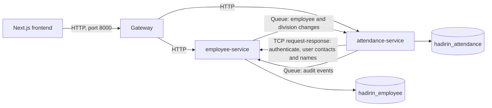

# Employee and attendance split plan

| Attribute | Value                                                         |
| --------- | ------------------------------------------------------------- |
| Status    | Proposed. Nothing is built.                                   |
| Date      | 2 November 2026                                               |
| Scope     | Local only: Docker Compose and dev servers. No production change. |
| Replaces  | `ARCHITECTURE.md` §3 principle 9, once this is built          |

## 1. Goal

Split the backend into two services with their own databases, behind one gateway, so that it meets the skill test objective "create API with microservices concept". The frontend and the API contract don't change.

**Out of scope:** deploying this, migrating production data, and splitting attendance, corrections or reports any further. The live site keeps running the current backend, so this work stays on its own branch until a production plan exists (§9).

## 2. Target



| Service              | Modules                                                                                  | Owns                                                                                                                        |
| -------------------- | ---------------------------------------------------------------------------------------- | --------------------------------------------------------------------------------------------------------------------------- |
| `employee-service`   | auth, users, employees, divisions, audit, uploads                                        | Organization, Role, User, Session, tokens, Employee, Division, AuditLog, Upload                                             |
| `attendance-service` | attendance, attendance-verification, corrections, work-settings, holidays, reports, notifications | Attendance, Idempotency, Correction, WorkSchedule, Holiday, Notification, all verification tables, OrganizationSettings, the replicas |
| `gateway`            | Routing only                                                                             | Nothing                                                                                                                     |

Auth sits with employees because a user and an employee are linked one to one, and inviting an employee creates a user in the same flow.

**Dependency rule:** the employee service never calls the attendance service. Only attendance calls employee, which prevents a loop where each needs the other to answer.

## 3. What the code already gives us

- **Transactions stay whole.** I read the attendance, corrections, verification, holidays, work-settings and employee transactions, and each stays on one side of the boundary. Corrections and attendance share a transaction, so they have to stay together, and they do.
- **The call surface is small.** The attendance side calls only six `EmployeesService` methods (`findProfileForUser`, `eligibleIdsOn`, `teamOf`, `accountsOf`, `reportingLineOf`, `summariesByIds`) and three `UsersService` methods (`namesByIds`, `contactsByIds`, `contactsWithPermission`).
- **Modules already talk through services,** apart from the database relations in §4.

## 4. The hard problems and the decisions

| # | Problem | Decision | Trade-off |
| --- | --- | --- | --- |
| 1 | Reports, corrections and verification filter and sort through `employee` relations (for example `orderBy employee.employeeNumber`, `employee.divisionId`). Calls between services can't page and sort correctly across two databases. | Attendance keeps a **replica** of Employee and Division in its own database. Attendance tables keep their foreign keys to the replica, so those queries barely change. All six employee methods read from it. | Data can lag for a moment (decision 3). |
| 2 | `JwtAuthGuard` checks the session on every request so logout takes effect immediately. | Attendance calls `auth.authenticate` on the employee service over TCP on each request. | One extra hop per request, and attendance requests fail if the employee service is down. Verifying the JWT locally would lose immediate logout, which is a behaviour change. |
| 3 | Replica lag: a new employee could be refused at check-in, and a deactivated one could check in, until the update arrives. | Accept it. Locally it's a very short window. Document it in `DOMAIN_RULES.md`. | A real rule gets slightly weaker. This is the honest cost of the split, so be ready to explain it. |
| 4 | Lost updates: today's employee events carry only field names, and a crash after commit could lose an update. | Publish the **full row** with `updatedAt` after each change, through BullMQ. The consumer ignores anything older than what it has. Add a `resync` request that re-pages all employees, used for first fill and repair. | No outbox table, so a crash can still leave the replica stale until a resync. Add an outbox before any production use. |
| 5 | The audit log is an in-process listener on events from every module. Photo views must always be audited (decision V9). | Audit stays in the employee service. Attendance sends its events through a BullMQ queue. | Audit entries arrive slightly later. A failed enqueue must log an error, and for photo views must refuse the view. |
| 6 | `Organization` holds attendance settings: timezone, retention, reminders, verification flags. | Identity columns (`name`, `deletedAt`) stay with employee. Settings move to a new `OrganizationSettings` table in attendance, with a copy of `name` and a row created from an `organization.created` event. | Another small replica. |
| 7 | `GET /me/context` in the employee module reads work settings, which would break the dependency rule. | Move that route to attendance. `/me/employee` stays. | The gateway has to route `/me` by full path. |
| 8 | `WorkSchedule` and `Holiday` return `createdBy` through a User relation. Corrections and notifications store user IDs with foreign keys. | Keep plain UUIDs without foreign keys. Fill names with `namesByIds`. | The database no longer enforces these links. |

**Transport:** TCP for request-response, because it needs no new infrastructure. BullMQ for events, because the Redis it uses is already running and it keeps messages if the consumer is down. Plain Redis pub/sub would lose them.

## 5. Code layout

Keep `backend/` as one package with several entry points, and leave `src/modules`, `src/common` and `src/infra` where they are:

```text
backend/src/apps/gateway/{main.ts, gateway.module.ts, routes.ts}
backend/src/apps/employee/{main.ts, employee.module.ts}
backend/src/apps/attendance/{main.ts, attendance.module.ts}
backend/prisma/employee/{schema.prisma, migrations/, seed.ts}
backend/prisma/attendance/{schema.prisma, migrations/, seed.ts}
```

This is a much smaller diff than Nest's monorepo mode, and it keeps the `@/` imports. The cost is that nothing physically stops a forbidden import, so a spec test must fail if a module imports across the boundary.

## 6. Gateway routes

| Service    | Prefixes under `/v1`                                                                                                                                                  |
| ---------- | --------------------------------------------------------------------------------------------------------------------------------------------------------------------- |
| employee   | `auth`, `users`, `roles`, `employees`, `divisions`, `audit-logs`, `uploads`, `me/employee`                                                                            |
| attendance | `attendance`, `attendance-verification`, `correction-requests`, `dashboard`, `reports`, `team/attendance`, `holidays`, `work-calendar`, `work-schedules`, `work-settings`, `notifications`, `me/context` |

The gateway listens on port 8000, so the frontend's `API_URL` doesn't change. It must pass the request ID on, stream the CSV export without buffering it, and forward the client IP. `TRUST_PROXY` has to be set correctly on both services, or the login rate limit will count every user as the gateway's IP.

## 7. Phases

Each phase ends with all tests passing. Phases 1–3 still run as one process, so they're safe and can stop at any point. Estimates are rough, for one developer.

| Phase | Work | Done when | Estimate |
| --- | --- | --- | --- |
| 1. Boundaries | Add `EmployeeDirectory` and `UserDirectory` interfaces with in-process adapters. Switch the attendance side to them. Move `/me/context`. Add the boundary spec test. | Existing unit and e2e tests pass unchanged. | 1 day |
| 2. Remove shared relations | Add `OrganizationSettings`. Drop Prisma relations to User and Organization on the attendance side, and fill names in the services. | Same tests pass. | 2 days |
| 3. Replicas and events | Add Employee and Division replica tables, repoint attendance foreign keys, publish changes through BullMQ, add the consumer and `resync`. Send audit through the queue. | Same behaviour, with tests changed only to wait for queued work. Tests added for out-of-order updates and resync. | 2–3 days |
| 4. Two databases | Split into two Prisma schemas and clients, with fresh initial migrations and two seeds. Add the second database to Compose. | `migrate deploy` and seed work from empty. The e2e suite passes. | 2 days |
| 5. Three processes | Add entry points, TCP clients and handlers, the gateway, and error mapping over TCP. Add `.claude/launch.json` entries. | Login, check-in with a photo, HR employee edit and HR report all work in a browser through port 8000. | 2–3 days |
| 6. Tests and docs | Boot both services in the e2e helpers. Merge the two OpenAPI documents. Update CI, READMEs, `ARCHITECTURE.md`, `DATA_MODEL.md` and `DOMAIN_RULES.md`. | All checks pass and the OpenAPI diff is empty. | 2 days |

**Total: roughly 11–13 working days.**

## 8. Things that are easy to miss

- **Error codes over TCP:** `AppError` subclasses must survive the hop with their code and status. The frontend's token refresh relies on the specific expired-token error, so a generic 500 or 401 would break sessions.
- **OpenAPI:** `backend/openapi.json` generates the frontend types, so the export has to merge both services. An empty diff is the proof that the contract hasn't changed.
- **Route auth audit:** `RouteAuthAuditor` must run in both services.
- **E2E tests:** `test/helpers.ts` uses one `AppModule` and one Prisma client, and specs write rows directly. It needs both apps, two clients and a way to wait for queued work. This is likely to be the largest unknown across the 19 spec files.
- **Scheduled jobs:** close-day and reminders move with attendance, and `organizationIds()` reads the new settings table.
- **Seeding:** the two seeds must run in order, with employee first, and then a resync.
- **Dev database:** this plan assumes a local reseed, so existing local data is thrown away.

## 9. Before this could go live

Not part of this work, but required first: a data migration for the existing database, an outbox for reliable events, service-to-service authentication on the TCP port (it trusts anyone who can reach it), hosting for three processes, and a rollback plan.

## 10. Decisions for the product owner

1. Is the replica lag in decision 3 acceptable? **Recommended: yes**, since the alternative of live checks would still leave reports needing a replica.
2. Should this reach the live site before submission? **Recommended: no.** Submit the branch with this plan, and state in the README that the live site runs the single-service version.
