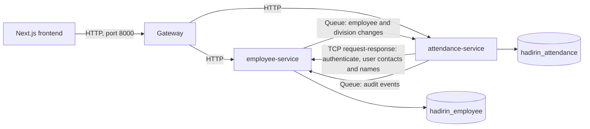

# Employee and attendance split

| Attribute | Value                                                         |
| --------- | ------------------------------------------------------------- |
| Status    | Built and tested. Live on the demo site since 2 November 2026, with the gaps in §9. |
| Date      | 2 November 2026                                               |
| Scope     | Docker Compose and dev servers, then the demo site (§9). |
| Replaces  | The single-service backend (see `ARCHITECTURE.md` §3, principle 9) |

## 1. Goal

Split the backend into two services with their own databases, behind one gateway, so that it meets the skill test objective "create API with microservices concept". The frontend and the API contract don't change.

**Out of scope at first:** deploying this and migrating production data, both since done (§9). Splitting attendance, corrections or reports any further stays out of scope.

## 2. Target



| Service              | Modules                                                                                  | Owns                                                                                                                        |
| -------------------- | ---------------------------------------------------------------------------------------- | --------------------------------------------------------------------------------------------------------------------------- |
| `employee-service`   | auth, users, employees, divisions, audit, uploads                                        | Organization, Role, User, Session, tokens, Employee, Division, AuditLog, Upload                                             |
| `attendance-service` | attendance, attendance-verification, corrections, work-settings, holidays, reports, notifications | Attendance, Idempotency, Correction, WorkSchedule, Holiday, Notification, all verification tables, OrganizationSettings, the replicas |
| `gateway`            | Routing only                                                                             | Nothing                                                                                                                     |

Auth sits with employees because a user and an employee are linked one to one, and inviting an employee creates a user in the same flow.

**Dependency rule:** the employee service never calls the attendance service. Only attendance calls employee, which prevents a loop where each needs the other to answer.

## 3. What the code already gives us

- **Transactions stay whole.** I read the attendance, corrections, verification, holidays, work-settings and employee transactions, and each stays on one side of the boundary. Corrections and attendance share a transaction, so they have to stay together, and they do.
- **The call surface is small.** The attendance side calls only six `EmployeesService` methods (`findProfileForUser`, `eligibleIdsOn`, `teamOf`, `accountsOf`, `reportingLineOf`, `summariesByIds`) and three `UsersService` methods (`namesByIds`, `contactsByIds`, `contactsWithPermission`).
- **Modules already talk through services,** apart from the database relations in §4.

## 4. The hard problems and the decisions

| # | Problem | Decision | Trade-off |
| --- | --- | --- | --- |
| 1 | Reports, corrections and verification filter and sort through `employee` relations (for example `orderBy employee.employeeNumber`, `employee.divisionId`). Calls between services can't page and sort correctly across two databases. | Attendance keeps a **replica** of Employee and Division in its own database. Attendance tables keep their foreign keys to the replica, so those queries barely change. All six employee methods read from it. | Data can lag for a moment (decision 3). |
| 2 | `JwtAuthGuard` checks the session on every request so logout takes effect immediately. | Attendance calls `auth.authenticate` on the employee service over TCP on each request. | One extra hop per request, and attendance requests fail if the employee service is down. Verifying the JWT locally would lose immediate logout, which is a behaviour change. |
| 3 | Replica lag: a new employee could be refused at check-in, and a deactivated one could check in, until the update arrives. | Accept it. Locally it's a very short window. Document it in `DOMAIN_RULES.md`. | A real rule gets slightly weaker. This is the honest cost of the split, so be ready to explain it. |
| 4 | Lost updates: today's employee events carry only field names, and a crash after commit could lose an update. | Publish the **full row** with `updatedAt` after each change, through BullMQ. The consumer ignores anything older than what it has. Add a `resync` request that re-pages all employees, used for first fill and repair. | No outbox table, so a crash can still leave the replica stale until a resync. Add an outbox before any production use. |
| 5 | The audit log is an in-process listener on events from every module. Photo views must always be audited (decision V9). | Audit stays in the employee service. Attendance sends its events through a BullMQ queue. | Audit entries arrive slightly later. A failed enqueue must log an error, and for photo views must refuse the view. |
| 6 | `Organization` holds attendance settings: timezone, retention, reminders, verification flags. | Identity columns (`name`, `deletedAt`) stay with employee. Settings move to a new `OrganizationSettings` table in attendance, with a copy of `name` and a row created from an `organization.created` event. | Another small replica. |
| 7 | `GET /me/context` in the employee module reads work settings, which would break the dependency rule. | Move that route to attendance. `/me/employee` stays. | The gateway has to route `/me` by full path. |
| 8 | `WorkSchedule` and `Holiday` return `createdBy` through a User relation. Corrections and notifications store user IDs with foreign keys. | Keep plain UUIDs without foreign keys. Corrections and notifications fetch names with `namesByIds`. Schedules and holidays store the name when created, because they're read on nearly every request. | The database no longer enforces these links, and a renamed user keeps their old name on past schedules and holidays. |

**Transport:** TCP for request-response, because it needs no new infrastructure. BullMQ for events, because the Redis it uses is already running and it keeps messages if the consumer is down. Plain Redis pub/sub would lose them.

## 5. Code layout

`backend/` is one package with several entry points. `src/modules`, `src/common` and `src/infra` stay where they were:

```text
backend/src/apps/gateway/{main.ts, gateway.module.ts, routes.ts}
backend/src/apps/employee/{main.ts, employee.module.ts}
backend/src/apps/attendance/{main.ts, attendance.module.ts}
backend/prisma/employee/{schema.prisma, migrations/}
backend/prisma/attendance/{schema.prisma, migrations/}
backend/prisma/seed.ts
```

This is a much smaller diff than Nest's monorepo mode, and it keeps the `@/` imports. The cost is that nothing physically stops a forbidden import, so `src/apps/service-boundaries.spec.ts` fails if a module imports across the boundary or touches the other service's database.

## 6. Gateway routes

| Service    | Prefixes under `/v1`                                                                                                                                                  |
| ---------- | --------------------------------------------------------------------------------------------------------------------------------------------------------------------- |
| employee   | `auth`, `users`, `roles`, `employees`, `divisions`, `audit-logs`, `uploads`, `me/employee`                                                                            |
| attendance | `attendance`, `attendance-verification`, `correction-requests`, `dashboard`, `reports`, `team/attendance`, `holidays`, `work-calendar`, `work-schedules`, `work-settings`, `notifications`, `me/context` |

The gateway is the frontend's only `API_URL`. It must pass the request ID on, stream the CSV export without buffering it, and forward the client IP. `TRUST_PROXY` has to be set correctly on both services, or the login rate limit will count every user as the gateway's IP.

## 7. How it was built

1. **Boundaries:** `EmployeeDirectory` and `UserDirectory` interfaces, with `/me/context` moved, while still one process. All tests passed unchanged.
2. **Split:** two Prisma schemas and databases, the replicas and queues, the TCP link, the gateway and the entry points.
3. **Initial migrations:** generated by applying the old migrations to a scratch database, removing the other service's objects, and dumping the result. That keeps the hand-written check constraints that Prisma's own schema diff would lose. `prisma migrate diff` shows no drift for either service.

**What proves it works:**

- The 255 existing e2e tests pass with only setup changes and one updated health check. Each test starts the gateway and both services as separate Nest apps on real ports, so every request crosses HTTP, TCP and the queues.
- `test/service-split.e2e-spec.ts` adds tests for the link itself: copying changes, stale messages, resync, immediate logout, error codes over TCP, and audit entries that keep their request ID.
- `openapi.json` is identical to the single-service version once key order is ignored, so the frontend didn't change.

## 8. Things that are easy to miss

- **Error codes over TCP:** `AppError` subclasses must survive the hop with their code and status. The frontend's token refresh relies on the specific expired-token error, so a generic 500 or 401 would break sessions.
- **OpenAPI:** `backend/openapi.json` generates the frontend types, so the export has to merge both services. An empty diff is the proof that the contract hasn't changed.
- **Route auth audit:** `RouteAuthAuditor` must run in both services.
- **E2E tests:** awaiting a request in a spec also waits for the queue messages it caused (`test/helpers.ts`), because specs check audit entries and copied rows straight after a response. Production callers don't get that wait.
- **Scheduled jobs:** close-day and reminders move with attendance, and `organizationIds()` reads the new settings table.
- **Seeding:** one script writes both databases directly, so it works before any service has started.
- **Dev database:** a new setup starts from the seed. Moving an existing single-service database is a separate step (§9).

## 9. Going live

The demo site moved to this version on 2 November 2026.

| Requirement | Status |
| ----------- | ------ |
| Data migration | Done: `backend/prisma/migrate-single-service-data.ts`. It only reads the source, needs empty targets, and commits both only after every row count matches. |
| Hosting for three processes | Done: one system service for each, plus the frontend. |
| Rollback plan | Done: the old app and its tables stay in place, disabled. Anything recorded after the switch would stay only in the new schemas. |
| Separate databases | **Not met.** The services use the `employee` and `attendance` schemas of one database, with one login, because creating databases needed an admin login that wasn't available. `?schema=` in the database URLs selects them. The code still keeps the services apart (`src/apps/service-boundaries.spec.ts`), but the database doesn't enforce it. |
| Service-to-service authentication on the TCP port | **Not built.** It trusts anyone who can reach it. It listens on 127.0.0.1 only. |
| Outbox for reliable events | **Not built.** A crash can lose an update between services; `pnpm db:resync` repairs the attendance service's copy. |

The two unbuilt items and the shared database were accepted for a demo with no real employee data. Close them before real data goes in.

## 10. Decisions made

1. **Replica lag is acceptable** (decision 3). Live checks wouldn't remove the need for a copy, because reports need one anyway.
2. **This doesn't go to the live site for now.** The live site runs the earlier single-service version from a separate repository.
